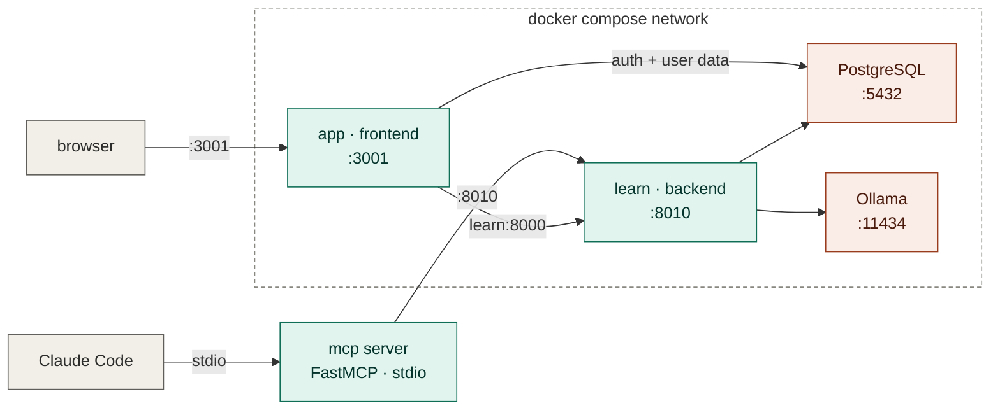
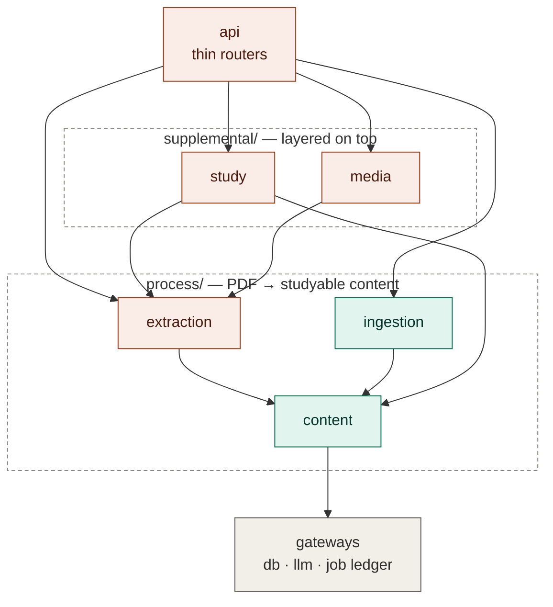
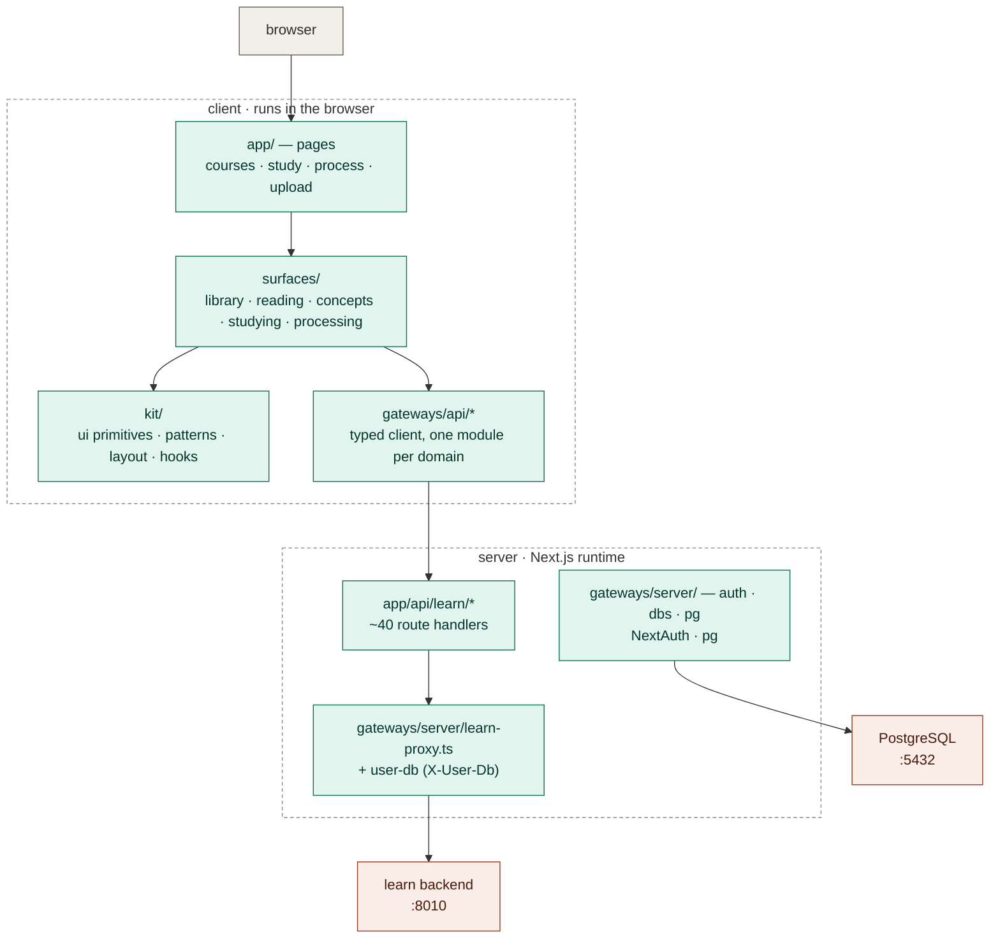
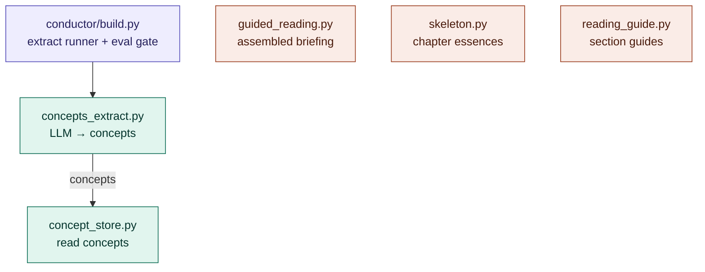

# Code map

A navigable map of the codebase. Two levels:

1. **System topology** — the running containers and which top-level directory each is.
2. **Backend packages** — the domain packages + the conductor inside `backend/`, and every file in them.

**How to use it:** the **tables** below each diagram are the file-level index — every file
name is a link that opens the file. The diagrams are color-coded to match and render with
color on GitHub; note that GitHub sandboxes Mermaid and strips node click-through, so the
tables (not the diagram boxes) are the reliable way to jump to a file there. The `click`
directives do work in Mermaid-aware editors (VS Code, Obsidian, mermaid.live). For the *why*
behind the structure, see [ARCHITECTURE.md](ARCHITECTURE.md).

Color key (all three diagrams): gray = clients / structural floor · teal = your code ·
coral = off-the-shelf services.

---

## 1. System topology

| Box | Directory | What it is |
|---|---|---|
| app | [`frontend/`](frontend) | Next.js UI + proxy layer (`/api/learn/*` → backend) |
| learn | [`backend/`](backend) | FastAPI service — everything in section 2 below |
| mcp | [`mcp/server.py`](mcp/server.py) | FastMCP server; drives the backend over REST only |
| compose / tools | [`deploy/compose/`](deploy/compose) | docker-compose + service images |
| Postgres / Ollama | (off-the-shelf images) | database · local LLM |

---

## 2. Backend packages

Arrows read **"depends on"** (a package imports the one it points to). The rule — domains
import `gateways` and `process/content`, never each other's internals; only `api` imports domains;
zero cycles — is enforced and explained in [ARCHITECTURE.md](ARCHITECTURE.md). Diagram is
simplified to the main edges; the file tables are complete.

Assembly point: [`backend/app/main.py`](backend/app/main.py) — middleware, routers, and
`install_job_runners()`.

<!-- GEN:backend START — auto-managed by scripts/gen_map.py; edit descriptions inline, they're preserved across regens -->

### gateways/ — connections to external programs (Postgres · Ollama) + the jobs ledger

> Gateways — the connections to programs outside this process. — [`__init__.py`](backend/app/gateways/__init__.py) is the facade: import this package, not its modules.

| File | Purpose |
|---|---|
| [`llm.py`](backend/app/gateways/llm.py) | Ollama client (plain httpx, native /api/chat) — schema-constrained JSON completions |
| [`llm_schemas.py`](backend/app/gateways/llm_schemas.py) | Pydantic schemas for structured LLM output |
| [`db.py`](backend/app/gateways/db.py) | Postgres pool + X-User-Db schema tenancy — the one DB seam |
| [`ledger.py`](backend/app/gateways/ledger.py) | Persistent job rows (enqueue/cancel/list/patch) — no worker; drained by conductor |

### process/ingestion/ — PDF in

> Ingestion — PDF in. — [`__init__.py`](backend/app/process/ingestion/__init__.py) is the facade: import this package, not its modules.

| File | Purpose |
|---|---|
| [`reader.py`](backend/app/process/ingestion/reader.py) | PDF → markdown (docling / pymupdf fallback) |
| [`pdf_convert.py`](backend/app/process/ingestion/pdf_convert.py) | Conversion job driver |

### process/content/ — the book itself

> Content — the book itself, and the one scope resolver. — [`__init__.py`](backend/app/process/content/__init__.py) is the facade: import this package, not its modules.

| File | Purpose |
|---|---|
| [`documents.py`](backend/app/process/content/documents.py) | Document metadata lookup ("which document / what is it") |
| [`sections.py`](backend/app/process/content/sections.py) | Markdown → `toc:` keyed section blocks (pure) |
| [`pages.py`](backend/app/process/content/pages.py) | Page provenance math (pure) |
| [`outline.py`](backend/app/process/content/outline.py) | Canonical TOC from bookmarks + block assignment (pure) |
| [`elements.py`](backend/app/process/content/elements.py) | Figures/tables: save, link, read |
| [`scope.py`](backend/app/process/content/scope.py) | THE scope owner: `scope_blocks` / `scope_section_keys` / `load_section_blocks` |
| [`store.py`](backend/app/process/content/store.py) | `persist_document` + section/page reads (was `arango_content.py`) |
| [`chapters.py`](backend/app/process/content/chapters.py) | Canonical chapter-unit list |
| [`math_markdown.py`](backend/app/process/content/math_markdown.py) | LaTeX/KaTeX math rendering |
| [`toc_tree.py`](backend/app/process/content/toc_tree.py) | Syllabus forest from the stored TOC outline |
| [`find.py`](backend/app/process/content/find.py) | Keyword search over section content (coverage-scored, no embeddings) |
| [`toc_controller.py`](backend/app/process/content/toc_controller.py) | Staged TOC routing loop (bookmarks / pagematched / none) + decision log (pure) |

### process/extraction/ — LLM generation passes

> Extraction — the LLM generation passes over stored content. — [`__init__.py`](backend/app/process/extraction/__init__.py) is the facade: import this package, not its modules.

| File | Purpose |
|---|---|
| [`concepts_extract.py`](backend/app/process/extraction/concepts_extract.py) | Concept extraction (the write side) |
| [`concept_store.py`](backend/app/process/extraction/concept_store.py) | Concept reads (section/document views, reading ranks) |
| [`skeleton.py`](backend/app/process/extraction/skeleton.py) | Chapter skeleton essences + orientation |
| [`reading_guide.py`](backend/app/process/extraction/reading_guide.py) | Per-section "what to look for" guides |
| [`eval_gate.py`](backend/app/process/extraction/eval_gate.py) | Critic gate — samples + grades each extraction run (quality as a number) |
| [`guided_reading.py`](backend/app/process/extraction/guided_reading.py) | _(describe me)_ |

### supplemental/study/ — learning state

> Study — the learning loop over extracted concepts. — [`__init__.py`](backend/app/supplemental/study/__init__.py) is the facade: import this package, not its modules.

| File | Purpose |
|---|---|
| [`reviews.py`](backend/app/supplemental/study/reviews.py) | SRS queue assembly + SM-2 grading (concept/skeleton/figure) |
| [`mastery.py`](backend/app/supplemental/study/mastery.py) | Event floor + mastery/activity/forecast read models |
| [`srs.py`](backend/app/supplemental/study/srs.py) | SM-2 schedule primitive |
| [`sessions.py`](backend/app/supplemental/study/sessions.py) | _(describe me)_ |
| [`calendar.py`](backend/app/supplemental/study/calendar.py) | _(describe me)_ |

### supplemental/media/ — audiobooks

> Media — audio renditions of chapters. — [`__init__.py`](backend/app/supplemental/media/__init__.py) is the facade: import this package, not its modules.

| File | Purpose |
|---|---|
| [`audiobook.py`](backend/app/supplemental/media/audiobook.py) | Checkpointed TTS job system |
| [`tts_orpheus.py`](backend/app/supplemental/media/tts_orpheus.py) | Orpheus TTS client |

### conductor/ — wires job kinds to domain runners + the auto-chain

> Conductor — decides what runs, and wires it. — [`__init__.py`](backend/app/conductor/__init__.py) is the facade: import this package, not its modules.

| File | Purpose |
|---|---|
| [`build.py`](backend/app/conductor/build.py) | Phase 2 runner: `extract` (+ eval gate); `build` is a compat alias |
| [`ingest.py`](backend/app/conductor/ingest.py) | Phase 1: stash upload + `convert` job runner |
| [`lifecycle.py`](backend/app/conductor/lifecycle.py) | Per-document state; extraction is on-demand (auto-chain opt-in via LEARN_AUTOCHAIN=1) |
| [`registry.py`](backend/app/conductor/registry.py) | Composition root — registers every job-kind runner |
| [`worker.py`](backend/app/conductor/worker.py) | The one daemon worker: runner registry, JobCtx, drain loop over the ledger |

### api/ — thin routers + composition root

> API — thin HTTP routers over the domains, one file per area of the app. — [`__init__.py`](backend/app/api/__init__.py) is the facade: import this package, not its modules.

| File | Purpose |
|---|---|
| [`reading_routes.py`](backend/app/api/reading_routes.py) | Reading guide + guided-reading reads |
| [`study_routes.py`](backend/app/api/study_routes.py) | Doing study: chapter path (orient/skeleton/progress) + the spaced-review queue |
| [`system_routes.py`](backend/app/api/system_routes.py) | Health, queue control, machine strip |
| [`content_routes.py`](backend/app/api/content_routes.py) | The book: courses list/delete, outline, chapters, sections, elements, figures, keyword search |
| [`concept_routes.py`](backend/app/api/concept_routes.py) | Concept layer: reads + curation (edit / delete) |
| [`media_routes.py`](backend/app/api/media_routes.py) | Audiobook TTS: voices, generate, status, timeline, MP3 stream |
| [`process_routes.py`](backend/app/api/process_routes.py) | Convert → extract → build queue/jobs + per-course pipeline status |
| [`progress_routes.py`](backend/app/api/progress_routes.py) | Study read models: mastery, activity, forecast, planner, sessions, mistakes |

<!-- GEN:backend END -->

---

## 3. Frontend (inside the `app` container)

The frontend is surface-partitioned: each screen you can stand on is a package under
`surfaces/`, gated by its `index.ts` hub, layered **kit ← gateways ← surfaces ← app**
(see [`frontend/ARCHITECTURE.md`](frontend/ARCHITECTURE.md)). Everything ultimately
reaches the backend through the **proxy layer**: a component calls `/api/learn/*`, a thin
route handler forwards it via
[`gateways/server/learn-proxy.ts`](frontend/src/gateways/server/learn-proxy.ts), which stamps
the `X-User-Db` tenancy header. Auth and the per-user document list are the paths that talk
to Postgres directly — every server-only module lives in
[`gateways/server/`](frontend/src/gateways/server).

| Layer | Location | What it is |
|---|---|---|
| pages | [`app/`](frontend/src/app) | Thin route entry points (+ `_chrome/` nav shell); each mounts a surface hub |
| surfaces | [`surfaces/`](frontend/src/surfaces) | `library/` (shelf + course home) · `reading/` (readers + guided-reading) · `concepts/` · `studying/` (review/walk/planner) · `processing/` (upload + build console) — each hub-gated |
| API client | [`gateways/api/`](frontend/src/gateways/api) | Typed fetchers, one module per domain (outline, content, concepts, progress, review, chapter, audiobook, planner, pipeline, system) + `toc.ts` outline helpers |
| kit | [`kit/`](frontend/src/kit) | `ui/` (shadcn) · `patterns/` (stat-tile, status-pill…) · `layout/` (brand, theme) · `hooks/` · `lib/` |
| server-only | [`gateways/server/`](frontend/src/gateways/server) | Everything that must never reach the client bundle (table below) |
| proxy routes | [`app/api/learn/`](frontend/src/app/api/learn) | ~40 thin handlers → backend (one per backend endpoint) |

Key `gateways/server/` seams:

| File | Purpose |
|---|---|
| [`learn-proxy.ts`](frontend/src/gateways/server/learn-proxy.ts) | The one door to the backend — GET/POST/DELETE + `X-User-Db` header |
| [`learn-upstream.ts`](frontend/src/gateways/server/learn-upstream.ts) | Where the learn backend lives (`LEARN_SERVICE_URL`) |
| [`user-db.ts`](frontend/src/gateways/server/user-db.ts) | Resolves the session's per-user schema name (tenancy) |
| [`auth.ts`](frontend/src/gateways/server/auth.ts) + [`auth-db.ts`](frontend/src/gateways/server/auth-db.ts) + [`pg.ts`](frontend/src/gateways/server/pg.ts) | NextAuth setup + Postgres user/auth reads (schema-per-tenant pool) |

---

## 4. Inside the extraction package

Extraction is the app's core feature, so here is the folder one level deeper. The extraction flow
itself is only two files (teal): [`concepts_extract.py`](backend/app/process/extraction/concepts_extract.py)
builds the prompt, calls the LLM and writes concepts (section loading + scope resolution
come from `process/content/scope.py`, the shared owner), and [`concept_store.py`](backend/app/process/extraction/concept_store.py)
is the read side. The **conductor** ([`conductor/build.py`](backend/app/conductor/build.py))
runs these as queue jobs (`extract`; `build` is a compat alias). Four other LLM *generation passes*
(coral) live in the folder and are triggered independently — `guided_reading` assembles
the reading briefing from cached artifacts (its per-concept explanations were retired).
Two dependencies live outside the folder: `concepts_extract` calls
`gateways/llm.py` for the model, and the conductor’s runners are dispatched by
`gateways/ledger.py` (the one queue).

Color key: purple = conductor · teal = extraction core · coral = generation passes.

---

## Where to start reading

Floor first (small, everything builds on these), then trace one journey:

1. [ARCHITECTURE.md](ARCHITECTURE.md) — the map's legend
2. [`gateways/db.py`](backend/app/gateways/db.py) → [`gateways/llm.py`](backend/app/gateways/llm.py) → [`process/content/scope.py`](backend/app/process/content/scope.py) → [`gateways/ledger.py`](backend/app/gateways/ledger.py)
3. Then a vertical slice — e.g. **build a chapter**: [`api/process_routes.py`](backend/app/api/process_routes.py) → [`gateways/ledger.py`](backend/app/gateways/ledger.py) → [`conductor/worker.py`](backend/app/conductor/worker.py) → [`conductor/registry.py`](backend/app/conductor/registry.py) → [`conductor/build.py`](backend/app/conductor/build.py) → [`extraction/concepts_extract.py`](backend/app/process/extraction/concepts_extract.py)
4. Or the **document lifecycle**: an upload flows [`api/process_routes.py`](backend/app/api/process_routes.py) → [`conductor/ingest.py`](backend/app/conductor/ingest.py) (convert job) → readable; then on-demand per-chapter [`conductor/build.py`](backend/app/conductor/build.py) (extract) → studyable, tracked by [`conductor/lifecycle.py`](backend/app/conductor/lifecycle.py)
