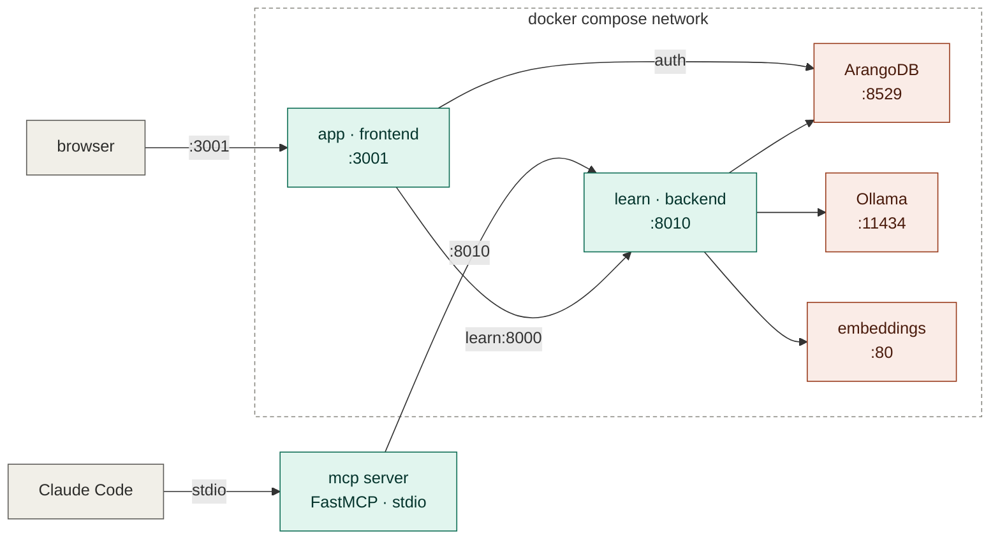
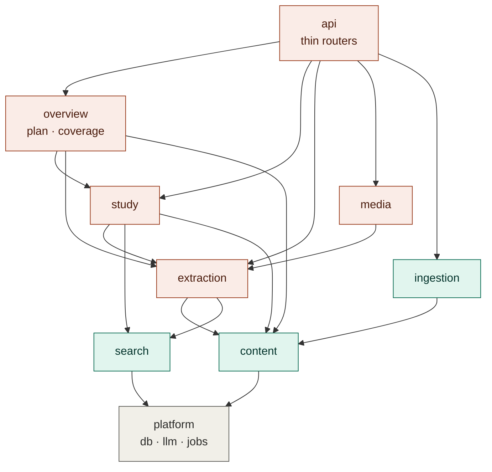
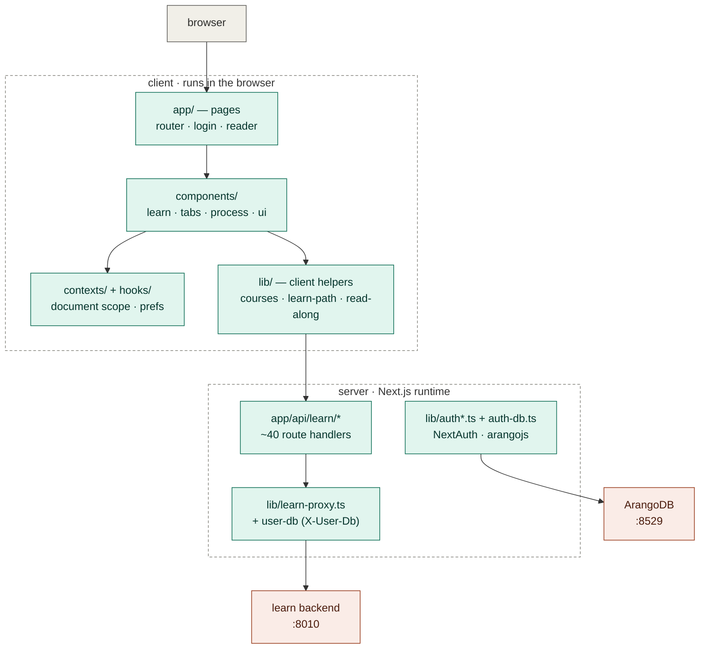
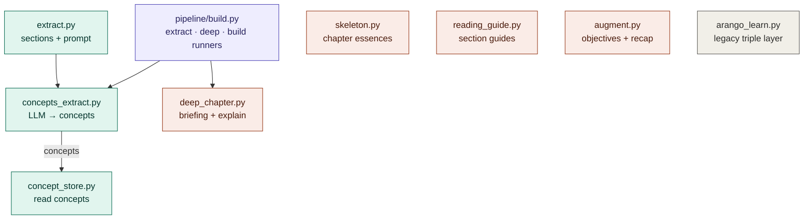

# Code map

A navigable map of the codebase. Two levels:

1. **System topology** — the running containers and which top-level directory each is.
2. **Backend packages** — the domain packages + the pipeline conductor inside `backend/`, and every file in them.

**How to use it:** the **tables** below each diagram are the file-level index — every file
name is a link that opens the file. The diagrams are color-coded to match and render with
color on GitHub; note that GitHub sandboxes Mermaid and strips node click-through, so the
tables (not the diagram boxes) are the reliable way to jump to a file there. The `click`
directives do work in Mermaid-aware editors (VS Code, Obsidian, mermaid.live). For the *why*
behind the structure, see [ARCHITECTURE.md](ARCHITECTURE.md).

Color key (all three diagrams): gray = clients / structural floor · teal = your code ·
coral = off-the-shelf services.

---

## 1. System topology

| Box | Directory | What it is |
|---|---|---|
| app | [`frontend/`](frontend) | Next.js UI + proxy layer (`/api/learn/*` → backend) |
| learn | [`backend/`](backend) | FastAPI service — everything in section 2 below |
| mcp | [`mcp/server.py`](mcp/server.py) | FastMCP server; drives the backend over REST only |
| compose / tools | [`deploy/compose/`](deploy/compose) | docker-compose + service images |
| ArangoDB / Ollama / embeddings | (off-the-shelf images) | database · local LLM · vector search |

---

## 2. Backend packages

Arrows read **"depends on"** (a package imports the one it points to). The rule — domains
import `platform` and `content`, never each other's internals; only `api` imports domains;
zero cycles — is enforced and explained in [ARCHITECTURE.md](ARCHITECTURE.md). Diagram is
simplified to the main edges; the file tables are complete.

Assembly point: [`backend/app/main.py`](backend/app/main.py) — middleware, routers, and
`install_job_runners()`.

<!-- GEN:backend START — auto-managed by scripts/gen_map.py; edit descriptions inline, they're preserved across regens -->

### platform/ — the floor (everything depends on this)

| File | Purpose |
|---|---|
| [`arango.py`](backend/app/platform/arango.py) | DB connection + per-user tenancy (the `X-User-Db` ContextVar) |
| [`llm.py`](backend/app/platform/llm.py) | Ollama client — free-text + structured/JSON completions |
| [`llm_schemas.py`](backend/app/platform/llm_schemas.py) | Pydantic schemas for structured LLM output |
| [`jobs.py`](backend/app/platform/jobs.py) | Persistent job ledger + worker; runners injected (no domain imports) |
| [`seedling_client.py`](backend/app/platform/seedling_client.py) | Optional vaultwriter seam (distilled-concept export) |

### content/ — the book itself

| File | Purpose |
|---|---|
| [`documents.py`](backend/app/content/documents.py) | Document metadata lookup ("which document / what is it") |
| [`sections.py`](backend/app/content/sections.py) | Markdown → `toc:` keyed section blocks (pure) |
| [`pages.py`](backend/app/content/pages.py) | Page provenance math (pure) |
| [`outline.py`](backend/app/content/outline.py) | Canonical TOC from bookmarks + block assignment (pure) |
| [`elements.py`](backend/app/content/elements.py) | Figures/tables: save, link, read |
| [`scope.py`](backend/app/content/scope.py) | Scope resolution — "what sections are inside chapter X" |
| [`store.py`](backend/app/content/store.py) | `persist_document` + section/page reads (was `arango_content.py`) |
| [`arango_tree.py`](backend/app/content/arango_tree.py) | TOC tree from `has_subsection` edges |
| [`chapters.py`](backend/app/content/chapters.py) | Canonical chapter-unit list |
| [`math_markdown.py`](backend/app/content/math_markdown.py) | LaTeX/KaTeX math rendering |

### ingestion/ — PDF in

| File | Purpose |
|---|---|
| [`reader.py`](backend/app/ingestion/reader.py) | PDF → markdown (docling / pymupdf fallback) |
| [`pdf_convert.py`](backend/app/ingestion/pdf_convert.py) | Conversion job driver |

### extraction/ — LLM generation passes

| File | Purpose |
|---|---|
| [`extract.py`](backend/app/extraction/extract.py) | Section loading + structural edges for extraction |
| [`concepts_extract.py`](backend/app/extraction/concepts_extract.py) | Concept extraction (the write side) |
| [`concept_store.py`](backend/app/extraction/concept_store.py) | Concept reads (section/document views, reading ranks) |
| [`deep_chapter.py`](backend/app/extraction/deep_chapter.py) | Chapter briefing + per-section explanations |
| [`skeleton.py`](backend/app/extraction/skeleton.py) | Chapter skeleton essences + orientation |
| [`reading_guide.py`](backend/app/extraction/reading_guide.py) | Per-section "what to look for" guides |
| [`augment.py`](backend/app/extraction/augment.py) | Section learning objectives + recap |
| [`arango_learn.py`](backend/app/extraction/arango_learn.py) | Legacy triple KG read-layer (deprecation candidate) |

### study/ — learning state

| File | Purpose |
|---|---|
| [`reviews.py`](backend/app/study/reviews.py) | SRS queue assembly + SM-2 grading (concept/skeleton/figure) |
| [`quiz_session.py`](backend/app/study/quiz_session.py) | MCQ build / stash answer / grade |
| [`concept_quiz_gen.py`](backend/app/study/concept_quiz_gen.py) | Deterministic (triple-based) quiz builder |
| [`concept_quiz_llm.py`](backend/app/study/concept_quiz_llm.py) | LLM-authored application questions + cache |
| [`mastery.py`](backend/app/study/mastery.py) | Per-concept mastery calibration + rollups |
| [`srs.py`](backend/app/study/srs.py) | SM-2 schedule primitive |
| [`cards.py`](backend/app/study/cards.py) | Card quizzability + distractor selection |
| [`drill.py`](backend/app/study/drill.py) | Drill on weak concepts |
| [`exam.py`](backend/app/study/exam.py) | Exam mode (multi-question scoring) |
| [`recall.py`](backend/app/study/recall.py) | Recall vs. recognition check |

### search/ — embeddings + semantic search

| File | Purpose |
|---|---|
| [`semantic_search.py`](backend/app/search/semantic_search.py) | Embed query → top-k content blocks + `ask` |
| [`lc_vectorstore.py`](backend/app/search/lc_vectorstore.py) | LangChain vector store over `content_vectors` (+ `_load_matrix`) |
| [`lc_embeddings.py`](backend/app/search/lc_embeddings.py) | Sentence-Transformer embeddings adapter |
| [`concept_resolve.py`](backend/app/search/concept_resolve.py) | Embedding helper for concept resolution |

### media/ — audiobooks

| File | Purpose |
|---|---|
| [`audiobook.py`](backend/app/media/audiobook.py) | Checkpointed TTS job system |
| [`tts_orpheus.py`](backend/app/media/tts_orpheus.py) | Orpheus TTS client |

### overview/ — cross-domain read models

| File | Purpose |
|---|---|
| [`plan.py`](backend/app/overview/plan.py) | Today plan (resume point, reviews due, next chapter) |
| [`coverage.py`](backend/app/overview/coverage.py) | Chapter × artifact-kind readiness/coverage grids |

### pipeline/ — the conductor — document lifecycle + job runners

| File | Purpose |
|---|---|
| [`build.py`](backend/app/pipeline/build.py) | Phase 2 runners: `extract` (core) / `deep` (overlay) / `build` |
| [`ingest.py`](backend/app/pipeline/ingest.py) | Phase 1: stash upload + `convert` job runner |
| [`lifecycle.py`](backend/app/pipeline/lifecycle.py) | Per-document state + auto-chain `converted → extract` |
| [`registry.py`](backend/app/pipeline/registry.py) | Composition root — registers every job-kind runner |

### api/ — thin routers + composition root

| File | Purpose |
|---|---|
| [`concept_study_routes.py`](backend/app/api/concept_study_routes.py) | Review queue, grading, quiz endpoints |
| [`admin_routes.py`](backend/app/api/admin_routes.py) | Curation / CRUD |
| [`build_routes.py`](backend/app/api/build_routes.py) | Job queue + coverage/readiness endpoints |
| [`extract_routes.py`](backend/app/api/extract_routes.py) | Extraction start/status + concept reads |
| [`audiobook_routes.py`](backend/app/api/audiobook_routes.py) | Audiobook generation/status |
| [`ingest_routes.py`](backend/app/api/ingest_routes.py) | PDF upload → conversion |
| [`learning_path_routes.py`](backend/app/api/learning_path_routes.py) | Learning-path (drill/exam/recall) |
| [`reading_routes.py`](backend/app/api/reading_routes.py) | Reading guide + deep-chapter reads |
| [`deep_chapter_routes.py`](backend/app/api/deep_chapter_routes.py) | Deep-chapter overlay |
| [`search_routes.py`](backend/app/api/search_routes.py) | Text + semantic search |
| [`study_routes.py`](backend/app/api/study_routes.py) | Quiz/drill/exam session state |
| [`system_routes.py`](backend/app/api/system_routes.py) | Health, queue control, machine strip |

<!-- GEN:backend END -->

---

## 3. Frontend (inside the `app` container)

The frontend is a layered data flow. Everything ultimately reaches the backend through the
**proxy layer**: a component calls `/api/learn/*`, a thin route handler forwards it via
[`lib/learn-proxy.ts`](frontend/lib/learn-proxy.ts), which stamps the `X-User-Db` tenancy
header. Auth is the one path that talks to ArangoDB directly.

| Layer | Location | What it is |
|---|---|---|
| pages | [`app/`](frontend/app) | Route entry points: the `#learn`/`#process` router, `login/`, `reader/` |
| components | [`components/`](frontend/components) | UI: `learn/` (study surfaces), `tabs/`, `process/`, `ui/` (primitives) |
| client state | [`contexts/`](frontend/contexts) + [`hooks/`](frontend/hooks) | Selected course scope + reading prefs/theme |
| client helpers | [`lib/`](frontend/lib) | Typed helpers the components call (table below) |
| proxy routes | [`app/api/learn/`](frontend/app/api/learn) | ~40 thin handlers → backend (one per backend endpoint) |

Key `lib/` seams:

| File | Purpose |
|---|---|
| [`learn-proxy.ts`](frontend/lib/learn-proxy.ts) | The one door to the backend — GET/POST/DELETE + `X-User-Db` header |
| [`learn-service.ts`](frontend/lib/learn-service.ts) | Shared response type definitions |
| [`user-db.ts`](frontend/lib/user-db.ts) | Resolves the session's per-user database name (tenancy) |
| [`auth.ts`](frontend/lib/auth.ts) + [`auth-db.ts`](frontend/lib/auth-db.ts) | NextAuth setup + arangojs user/auth reads |
| [`courses.ts`](frontend/lib/courses.ts) · [`learn-path.ts`](frontend/lib/learn-path.ts) · [`read-along.ts`](frontend/lib/read-along.ts) | Course listing · prereq path · audiobook/text sync |

---

## 4. Inside the extraction package

Extraction is the app's core feature, so here is the folder one level deeper. The pipeline
itself is only three files (teal): [`extract.py`](backend/app/extraction/extract.py) loads a
chapter's sections and builds the prompt, [`concepts_extract.py`](backend/app/extraction/concepts_extract.py)
calls the LLM and writes concepts, and [`concept_store.py`](backend/app/extraction/concept_store.py)
is the read side. The **pipeline conductor** ([`pipeline/build.py`](backend/app/pipeline/build.py))
runs these as queue jobs (`extract` / `deep` / `build`). Four other LLM *generation passes*
(coral) live in the folder but are triggered independently — only `deep_chapter` runs as part
of the `build` job, as the overlay after concepts are written.
[`arango_learn.py`](backend/app/extraction/arango_learn.py) (gray) is dead legacy from the
pruned triple pipeline. Two dependencies live outside the folder: `concepts_extract` calls
`platform/llm.py` for the model, and the pipeline runners are dispatched by
`platform/jobs.py` (the one queue).

Color key: purple = conductor · teal = extraction core · coral = generation passes · gray = legacy.

---

## Where to start reading

Floor first (small, everything builds on these), then trace one journey:

1. [ARCHITECTURE.md](ARCHITECTURE.md) — the map's legend
2. [`platform/arango.py`](backend/app/platform/arango.py) → [`platform/llm.py`](backend/app/platform/llm.py) → [`content/scope.py`](backend/app/content/scope.py) → [`platform/jobs.py`](backend/app/platform/jobs.py)
3. Then a vertical slice — e.g. **build a chapter**: [`api/build_routes.py`](backend/app/api/build_routes.py) → [`platform/jobs.py`](backend/app/platform/jobs.py) → [`pipeline/registry.py`](backend/app/pipeline/registry.py) → [`pipeline/build.py`](backend/app/pipeline/build.py) → [`extraction/concepts_extract.py`](backend/app/extraction/concepts_extract.py)
4. Or the **document lifecycle**: an upload flows [`api/ingest_routes.py`](backend/app/api/ingest_routes.py) → [`pipeline/ingest.py`](backend/app/pipeline/ingest.py) (convert job) → auto-chained [`pipeline/build.py`](backend/app/pipeline/build.py) (extract) → studyable, tracked by [`pipeline/lifecycle.py`](backend/app/pipeline/lifecycle.py)
