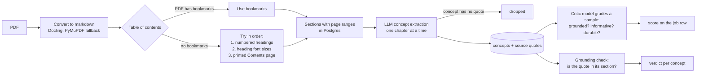

# Learn Hub

[](https://github.com/Aiden-Ferrante/learnhub-core/actions/workflows/backend-tests.yml)

A document pipeline that reads a textbook PDF, works out its table of contents, has an LLM
pull out the key concepts with a quote from the book for each one, and then checks that
work twice: a second model grades a sample, and a string check confirms each quote is
really in the section it claims to come from.

**Result:** on 2026-08-25 the grounding check ran over every stored concept, 1,463 of them
across 14 books. All 1,463 quotes were found in their own section: 0 invented, 0 taken from
the wrong section ([cycle record](docs/cycles/ABORTED%20v0.20.0%20%E2%80%94%20Show%20your%20work.md)).
That proves the quotes are real. It does not prove the explanation built on each quote is
right; that still needs a person to read it. The backend suite runs from a fresh clone with
no services: 182 passed, 30 skipped (Postgres tests, opt in with `LEARN_PG_TESTS=1`),
1 xfailed. With Postgres, as CI runs it: 212 passed, 1 xfailed.

## How a PDF becomes checked concepts



1. **Convert.** [`process/ingestion/reader.py`](backend/app/process/ingestion/reader.py)
   turns the PDF into markdown with Docling and falls back to PyMuPDF if Docling fails.
2. **Find the structure.** [`toc_controller.py`](backend/app/process/content/toc_controller.py)
   uses the PDF's bookmarks when it has them. When it does not, it tries
   [strategies](backend/app/process/content/toc_strategies/) in a fixed order: headings the
   book numbered itself, then heading font sizes, then the printed Contents page. Each step
   writes down why it accepted or declined, so a strange book can be diagnosed from the log.
   An LLM strategy is registered but is a stub that always declines.
3. **Extract concepts.** [`concepts_extract.py`](backend/app/process/extraction/concepts_extract.py)
   asks a local model, one section at a time, for concepts as schema-checked JSON. Each
   concept has a short explanation and the sentence from the book that supports it. A
   concept with no supporting sentence is dropped.
4. **Grade a sample.** After every extraction run,
   [`eval_gate.py`](backend/app/process/extraction/eval_gate.py) has a second model judge
   8 of the new concepts on three questions: is every claim in the quote, does it explain
   anything, and is it a general idea rather than a one-off fact. The pass rate is saved
   with the job, so a prompt change gets a number. It never blocks or fails an extraction.
5. **Check the quotes.** [`grounding.py`](backend/app/process/extraction/grounding.py) gives
   each concept one of 8 verdicts: `verbatim`, `partial`, `near-verbatim`, `paraphrase`,
   `elsewhere`, `invented`, `ungated`, or `no-section-text`. Only `invented`, `elsewhere` and
   `ungated` count as failures. Run it over a real library with
   [`scripts/check_grounding.py`](scripts/check_grounding.py); CI runs
   [`test_grounding_pg.py`](backend/tests/test_grounding_pg.py), which seeds one concept of
   every verdict, including an invented quote, so the check is shown to fail when it should.

The same idea is used to build **exam packs**
([`process/packs/`](backend/app/process/packs/)): each question must quote a section, the
quote is checked against the stored text, and a second model judges what is left. Anything
dropped is listed with its reason.

Around the pipeline is a study app: a Next.js reader, and recall drills scheduled with FSRS
spaced repetition.

**Models.** By default every LLM call goes to a local [Ollama](https://ollama.com), so no API
key is needed. Claude is optional: a model named `claude:<model>` (for example
`claude:sonnet`) is sent through the `claude` CLI on the host, using your own login
([`gateways/llm.py`](backend/app/gateways/llm.py)). Inside Docker, where there is no CLI,
those calls go through [`scripts/claude_bridge.py`](scripts/claude_bridge.py), a small
token-protected server on the host. Nothing uses Claude unless you pick a `claude:` model.

## Quickstart

Tests only, no Docker. `requirements.txt` pulls docling and torch, so the first install is a
large download.

```bash
git clone https://github.com/Aiden-Ferrante/learnhub-core.git && cd learnhub-core
uv venv .venv && VIRTUAL_ENV=.venv uv pip install -r backend/requirements.txt pytest
.venv/bin/python -m pytest backend/tests -q
```

The full app (Next.js 15 + React 19 UI, FastAPI backend, Postgres, Ollama) runs under Docker
Compose. See [Running the full stack](#running-the-full-stack).

## What went wrong / what I learned

- **The TOC pass guessed structure the book had already stated.** It clamped headings to three
  levels and returned 81 entries for a book with seven chapters; a title-matching pointer then
  collapsed 67 of 81 blocks into the last section, feeding extraction 558 characters of the
  wrong chapter. Now a book that numbers its headings is read by that numbering first
  (`from-numbered-headings`, CHANGELOG [0.15.0]).
- **The quote check only checked that a quote existed.** Extraction dropped a concept with an
  empty quote, but a model that made up a believable quote passed. Nobody had measured it.
  `grounding.py` now measures it, and it sorts misses by kind. The 134 near-misses turned out
  to be damage in the model's output, not made-up quotes: JSON decoding turned `\text` into a
  tab plus `ext`, and some characters came out as raw byte tokens like `<0xE2><0x84><0x92>`.
  Counting those as failures would have buried the real signal.
- **A check over an empty database proves nothing.** CI's database has no concepts, so a
  grounding script there would pass forever. The CI test seeds its own data, including one
  bad quote, so it can actually fail.
- **Fire-and-forget hid a total failure.** `/api/engagement` raised a `TypeError` on every
  call since it shipped, and nothing reported it. v0.15.0 became an audit of every place the
  app answered confidently and wrongly instead of admitting it did not know.

## Why

Reading a textbook and *knowing* a textbook are different activities, and most tools only
help with the first. PDF readers give you pages; flashcard apps give you a review queue but
make you author every card by hand; note apps store what you already understood.

Learn Hub closes the loop. It converts a PDF into a navigable structure (parts → chapters →
sections), runs an LLM over a chapter to extract its concepts, and turns those into two
graded activities — **skeleton recall** (can you reconstruct the chapter's shape?) and
**concept recall** (do you know the ideas inside it?). Both feed one FSRS-scheduled review
queue, so the system decides what is due rather than asking you to.

Extraction is per-chapter and on demand: a whole-book LLM pass is hours, not seconds, and
studying chapter 2 shouldn't wait on chapter 40.

## Running the full stack

Requirements: Docker with Compose, and ~8 GB free for models. An NVIDIA GPU is optional but
strongly recommended — the converter and extraction passes are much slower on CPU.

```bash
git clone https://github.com/Aiden-Ferrante/learnhub-core.git
cd learnhub-core

cp deploy/compose/.env.example deploy/compose/.env
# Fill in both values; compose fails fast if either is empty:
#   POSTGRES_PASSWORD  — database password
#   AUTH_SECRET        — session signing key, e.g. openssl rand -base64 32

./start.sh
```

Then open <http://localhost:3001>.

Pull the models the stack expects (once):

```bash
docker compose -f deploy/compose/docker-compose.yml exec ollama \
  ollama pull nemotron-3-nano:30b   # OLLAMA_MODEL, the default for any unset role
docker compose -f deploy/compose/docker-compose.yml exec ollama \
  ollama pull gemma4:latest         # concept extraction + critic pass
```

`./stop.sh` stops everything **except** Ollama, which is shared with other local apps and is
managed independently.

> **First login:** Learn Hub has no self-serve signup. Accounts are rows in the `auth.users`
> table (username, bcrypt-style `password_hash`, and a tenant `schema_name`) and are inserted
> directly against Postgres. A provisioning command is a known gap — see [Status](#status).

## Ports

| Port | Service | Notes |
|---|---|---|
| `3001` | `app` — Next.js 15 UI | The only port you open in a browser |
| `8010` | `learn` — FastAPI engine | Bound to `127.0.0.1` only |
| `5432` | `postgres` | The single datastore |
| `11434` | `ollama` | **Shared** with other local apps; not owned by this stack |

## Seam

How other things talk to Learn Hub, and how its pieces talk to each other:

- **Browser → `app` (:3001).** The Next.js layer owns auth and the UI, and proxies
  `/api/learn/*` through to the backend.
- **`app` → `learn` (:8010)** over `LEARN_SERVICE_URL`, attaching an **`X-User-Db`** header.
  That header is the tenancy seam: it selects the caller's Postgres schema, so one deployment
  serves multiple users without their data mixing.
- **`learn` → Ollama** over `OLLAMA_BASE_URL`. Ollama is deliberately *not* owned by this
  stack — `stop.sh` uses `rm -sf` on the other services rather than `down`, because `down`
  would tear out the compose network and detach the still-running shared container.
- **Postgres is the one datastore.** Auth, documents, extracted concepts, and study state all
  live there; ArangoDB and Qdrant were retired.

## Layout

```
frontend/   Next.js 15 + React 19 (pnpm) — auth, UI, proxy layer
backend/    FastAPI service — a domain-partitioned modular monolith
deploy/     compose stack, service Dockerfiles, Postgres init SQL
docs/       ADRs, specs, generated code map
scripts/    repo checks (import rules, grounding, chapter drift), the Claude bridge, MAP.md generator
```

```
backend/app/
  gateways/            Postgres, the job queue table, the LLM client (Ollama or claude:)
  process/ingestion/   PDF -> markdown
  process/content/     the book: TOC, sections, pages, figures
  process/extraction/  concept extraction, critic eval, grounding check
  process/packs/       exam-pack authoring + the snippet sandbox
  supplemental/        study state (FSRS reviews, packs) and audiobooks
  conductor/           the job worker: which job runs which step
  api/                 thin FastAPI routes
```

Imports only point down: `gateways ← process/content ← process/* and supplemental/* ←
conductor ← api`. Each package's `__init__.py` is the only thing other packages may import.
`scripts/check_hubs.py` (backend) and `frontend/scripts/check-hubs.mjs` (frontend) enforce
this in the code-map CI workflow.

Read [ARCHITECTURE.md](ARCHITECTURE.md) for the design and [MAP.md](MAP.md) for a
file-level index. Decisions are recorded in [docs/adr/](docs/adr/).

## Development

```bash
./start.sh --dev-frontend    # frontend only, hot reload on :3000, no Docker

# Rebuild after changing backend or frontend source:
docker compose -f deploy/compose/docker-compose.yml build learn
docker compose -f deploy/compose/docker-compose.yml up -d learn

# Backend tests:
docker run --rm \
  -v "$PWD/backend/app:/app/app" -v "$PWD/backend/tests:/app/tests" \
  compose-learn:latest sh -c "pip install -q pytest; python -m pytest tests -q"
```

Task tracking uses [Backlog.md](https://github.com/MrLesk/Backlog.md) — `backlog task list`.

## Status

Working and in daily use. `/health` returns `{ok, checks, freshness}`: Postgres and Ollama
checks, plus how recently the job queue moved. Known gaps, tracked rather than hidden:

- **No account provisioning command.** Users are inserted into `auth.users` by hand.
- **No Makefile.** The stack is driven by `start.sh` / `stop.sh`; there is no
  `make dev` / `make prod` / `make test`.

## License

See [LICENSE](LICENSE).
